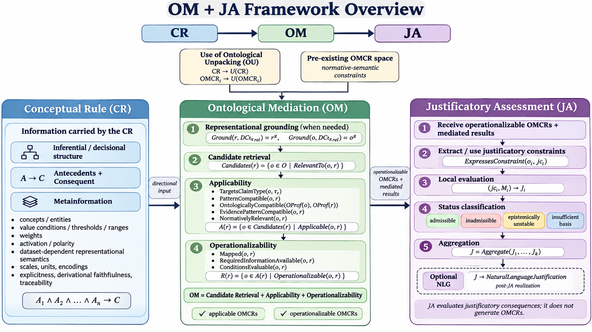

# Ontological Mediation + Justificatory Assessment

## 1. Scope and definition

The framework addresses a specific problem: how to assess the justificatory status of Conceptual Rules produced by empirical-predictive processes by confronting them with independently constituted, ontologically mediated normative-semantic structures. OM performs this mediation; JA subsequently evaluates the justificatory consequences of the mediated result.

Ontological Mediation (OM) is the context-sensitive process through which a Conceptual Rule (CR) is confronted with a pre-existing space of Ontologically Mediated Concept Rules (OMCRs), identifying which rules satisfy the relevant ontological, representational, evidential, and normative applicability conditions and which of them can be effectively operationalized in the concrete case.

**Figure 1**. Overview of the OM + JA framework, showing the Conceptual Rule (CR) as the directional input, the internal stages of Ontological Mediation (OM)—including representational grounding, candidate retrieval, applicability, and operationalizability—and the subsequent Justificatory Assessment (JA), which evaluates justificatory constraints and aggregates local assessment outcomes.

Here, context-sensitive does not presuppose a generic external context parameter: contextual sensitivity is supplied by information already represented in the CR and OMCRs, by dataset-derived representational grounding when required, and by any explicitly identified information required by a specific OMCR.

OM = context-sensitive matching between a Conceptual Rule and a pre-existing normative-semantic OMCR space

OM = retrieval + applicability + operationalizability

Mediation does not generate OMCRs and does not, by itself, determine the justificatory status of the claim. OMCRs belong to the pre-existing semantic-normative infrastructure; justificatory evaluation is performed subsequently by Justificatory Assessment (JA).

**Table 1. Three architecturally distinct functions**

| **Component**                                                                               | **Central question**                                                           | **Role in the framework**                                                                                                                | **Result**                                                            |
|---------------------------------------------------------------------------------------------|--------------------------------------------------------------------------------|------------------------------------------------------------------------------------------------------------------------------------------|-----------------------------------------------------------------------|
| Ontological Unpacking (OU) [Guizzardi and Guarino (2023)](https://arxiv.org/abs/2304.11124) | What commitments are implicit in r\*?                                          | The framework uses OU to make explicit relevant ontological commitments of the representations examined.                                 | Explicit profiles/structures that feed mediation.                     |
| Ontological Mediation (OM)                                                                  | Which pre-existing OMCRs are relevant, applicable and operationalizable for r? | Retrieves, confronts, and filters pre-existing OMCRs in light of the CR, derived profiles, and representational grounding when required. | Set of applicable and operationalizable OMCRs; mediated result.       |
| Justificatory Assessment (JA)                                                               | What justificatory status follows from evaluating the mediated result?         | Assesses the justificatory consequences of the mediated relation.                                                                        | admissible; inadmissible; epistemically unstable; insufficient basis. |

\* r : ConceptualRule

## 2. Directional input and mediation context

The Conceptual Rule is the only directional input originating from the empirical-predictive process. The framework does not fully reconstruct or assess the epistemic context that gave rise to the CR; it takes the rule as the available outcome of that process. However, its proper interpretation may depend on empirical-representational information associated with the dataset and the pipeline that produced it, such as definitions and scales of variables, units of measurement, thresholds, encodings, normalizations, weights, polarities, and other metadata. In the case study, for example, part of this semantics is determined by [OASIS-2](https://sites.wustl.edu/oasisbrains/home/oasis-2/).

This information constitutes a relevant representational context, denoted here by DCtxᵣₑₗ. This context does not belong exclusively to the CR. Although OMCRs have a distinct conceptual origin, being constituted from historically articulated normative, scientific, or disciplinary knowledge, ontology, and a Normative-Epistemic Context (NEC), their application to the concrete case may also require grounding in the representational conditions defined by the dataset. Thresholds, scales, units, and other quantitative conditions expressed or required by an OMCR can only be properly interpreted and evaluated in relation to the way the corresponding concepts are represented in the case.

There is, therefore, an asymmetry of origin combined with shared operational dependence. The CR has empirical-predictive provenance; the OMCR has normative-semantic provenance. The NEC supports the constitution and normative grounding of OMCRs, whereas DCtxᵣₑₗ provides the representational grounding required to interpret the CR and, when required, to instantiate or operationalize the OMCR conditions in the concrete case. Conceptually, the OMCR is normatively independent of the dataset, but it may be operationally grounded in its specific representation.

Thus, Ontological Mediation does not simply confront a contextualized CR with an OMCR that is entirely independent of its representational context. It relates a Conceptual Rule interpreted within its relevant empirical-representational context to OMCRs that are normatively constituted independently but, when necessary, operationally grounded in that same context to ensure comparability and evaluability in the concrete case.

## 3. Conceptual Rule

A Conceptual Rule (r) is an explicit inferential or decisional structure at the conceptual level. OM does not need to know internally the mechanism that produced r. Its origin may be diverse: conceptual models, trees, rules extracted from models, regressions, knowledge graphs, expert systems, or other architectures capable of providing a traceable conceptual representation. See [Concept-Rule Base (CRB): Conceptualization, Knowledge Graphs, Generalization, and Research Scope](https://github.com/em4ttos/Ontological-Mediation-in-Explainable-Artificial-Intelligence/blob/main/docs/formalization/concept-rule-base.md).

The requirement is that the rule preserve sufficient information for its concepts, relations, contributions, and outcome to be examined and confronted with the OMCR space.

ConceptualRule = explicit concept-level inferential/decisional structure

Three properties are particularly important: Explicitness; Derivational Faithfulness; and Traceability.

### 3.1. Logical structure and metainformation

A₁ ∧ A₂ ∧ ··· ∧ Aₙ → C

Each antecedent may carry additional metainformation:

Aᵢ = (eᵢ, pᵢ, wᵢ, πᵢ, rᵢ, …)

- eᵢ: entity or concept;

- pᵢ: property or characteristic;

- wᵢ: weight or importance;

- πᵢ: polarity;

- rᵢ: range, interval, or value restriction.

These elements do not all belong to the same semantic layer. For example, in Age \> 65, weight = 0.73, polarity = positive, Age has an ontological dimension, \>65 is a quantitative/contextual condition, and weight and polarity may belong to the inferential or model semantics.

Ontological + Quantitative + Inferential

ConceptualContribution ≠ OntologicalExistence

### 3.2. Detailing the example

CR₁: (Age \> 65, w = 0.73, π = +) ∧ (nWBV \< 0.70, w = 0.81, π = −) → Demented

The reading is as follows:

- Age and nWBV are the concepts/properties with an ontological dimension;

- \>65 and \<0.70 are quantitative restrictions or ranges;

- (w = 0.73) and (w = 0.81) represent quantitative values associated with the contribution of the antecedents to the decision or inference expressed by the CR. The exact nature of (w) depends on the mechanism that generated the rule: it may correspond, for example, to a coefficient derived from a statistical regression, to a weight, degree, or contribution strength in fuzzy modeling, or to a value produced by an explanation method. Consequently, (w) does not represent an ontological property of the entity or quality corresponding to the antecedent; it is model-dependent information whose interpretation requires reference to the model, the method, and, when pertinent, the representational context of the dataset.

- π = + and π = − represent, in the context of CEM modeling, the activation state of the concept in the extracted rule. Polarity is not an ontological property of the concept and, in this context, should not simply be interpreted as a positive or negative “direction” of contribution. It records whether or not the corresponding concept was activated in the conceptual configuration supporting the rule produced by the model. Thus, an expression such as π = + indicates that the concept appears activated in the rule, whereas π = − indicates its non-activation, according to the representational convention adopted by the CEM method. This information belongs to the representational/inferential level of the Conceptual Rule and must be distinguished from the ontological existence of the entity or quality corresponding to the concept. Consequently, the non-activation of a concept does not imply its ontological non-existence. For example, a negative representation associated with (Age) does not mean that the quality Age does not exist in the individual, but only that the corresponding concept was not activated in that conceptual rule generated by the CEM.

- Demented is the consequent of the rule.

Structural representation

CR₁ = ⟨ AntCR, ConsCR, MetaCR ⟩

AntCR = { a₁, a₂ }

a₁ = ⟨ Age, \>65, 0.73, + ⟩

a₂ = ⟨ nWBV, \<0.70, 0.81, − ⟩

ConsCR = Demented

A still more disciplined form is to make the structure of each antecedent explicit:

aᵢ = ⟨ Conceptᵢ, ValueConditionᵢ, Weightᵢ, Polarityᵢ ⟩

a₁ = ⟨ Age, \>65, 0.73, positive ⟩

a₂ = ⟨ nWBV, \<0.70, 0.81, negative ⟩

Semantic layers

For the first antecedent, the components have distinct statuses:

Age + \>65 + 0.73 + positive

ontological + quantitative + model/explanatory + inferential

This allows the framework to separate three different questions:

- What is Age ontologically?

- What quantitative condition on Age is being used?

- What model-dependent importance and activation state were associated with Age in this rule?

**Polarity as a conceptual activation state, not as an ontological property**

Particular care is required in interpreting polarity. In the specific context of rules generated by Concept Embedding Models (CEM), the signs (\pi=+) and (\pi=-) should be understood in terms of the activation state of the concept in the extracted rule, according to the representational convention adopted by the method. Thus, (\pi=+) indicates that the corresponding concept was activated in the conceptual configuration supporting the rule, whereas (\pi=-) indicates its non-activation.

This polarity therefore belongs to the representational/inferential level of the Conceptual Rule and does not express an intrinsic ontological property of the represented concept. In particular, the non-activation of a concept does not imply its ontological non-existence. A negative representation associated with (Age), for example, does not mean that the quality Age does not exist in the individual; it means only that the corresponding concept was not activated in that rule generated by the CEM.

Accordingly, the relevant distinction can be expressed as: Conceptual Activation ≠ Ontological Existence. A more explicit version of the rule can be represented as:

CR1: \[Age\>65; Weight=0.73; Activation(Age)=+\] ∧ \[nWBV\<0.70; Weight=0.81; Activation(nWBV)=-\]

→ Demented

In this representation, (Age) and (nWBV) designate the relevant concepts or properties; (\>65) and (\<0.70) express quantitative conditions dependent on the representation adopted in the dataset; the weights (0.73) and (0.81) are model-dependent information; and the signs (+) and (-), in the case of rules generated by CEM, record the activation state of the respective concepts.

The example thus shows that a single Conceptual Rule may simultaneously carry ontological, quantitative, and representational/inferential content, without these layers being conflated. The semantics of polarity must remain dependent on the mechanism that generated the CR: for rules originating from CEM, it should be interpreted specifically as a conceptual activation state, and not as an ontological property nor, generically, as a positive or negative direction of contribution.

## 4. Ontologically Mediated Concept Rules (OMCRs)

OMCRs are pre-existing normative-semantic artifacts. The Conceptual Rule provides the object against which the relevance, applicability, and operationalizability of the OMCRs will be assessed.

o₁, o₂, …, oₙ ∈ OMCR

As a provisional functional decomposition, and not as a definitive ontological definition, an OMCR may be represented as:

o = ⟨ Target, Pattern, OntologicalConditions, EvidenceConditions, NormativeConditions, Constraint ⟩

In relational terms, predicates of the following kind may be relevant:

TargetsClaimType(o, τ)

o is an OMCR and τ is a claim type; the predicate filters OMCRs by semantic target.

PatternCompatible(o, r)

checks structural/representational compatibility between the OMCR o and the CR r.

OntologicallyCompatible(OProf(o), OProf(r))

checks whether the ontological conditions required by o are compatible with the commitments made explicit in the ontological profiles derived from o and r.

EvidencePatternCompatible(o, r)

checks whether the type or pattern of evidence required by the OMCR is pertinent to the case structure represented by the CR; it does not assert that the required evidence is available.

NormativelyRelevant(o, r)

expresses the pertinence of the normative constraint already incorporated into the OMCR with respect to the CR; no additional generic normative context is presupposed.

ExpressesConstraint(o, jc)

states that o expresses the justificatory constraint jc; it does not state that jc has been satisfied. Its evaluation belongs to JA.

These signatures are the same relations used in the consolidated applicability formulation of Section 6; no separate EvidenceContext, NCase, or other generic contextual parameter is assumed in the core formalization.

### 4.1. Structural homology and epistemic asymmetry

CR and OMCR may exhibit partial structural homology: both may contain antecedents, a consequent, weights, polarities, ranges, and other metainformation. This structural symmetry, however, does not imply epistemological equivalence.

CR = ⟨ AntCR, ConsCR, MetaCR ⟩

OMCR = ⟨ AntOMCR, ConsOMCR, MetaOMCR ⟩

Ant designates antecedents; Cons designates the consequent; Meta collects metainformation such as weights, polarities, thresholds, intervals, provenance, confidence, and other representational metadata.

structural symmetry + epistemic asymmetry

The CR expresses, approximately, what the process/model is saying in that case. The OMCR expresses a previously mediated normative-semantic structure against which that claim can be examined.

## 5. Use of Ontological Unpacking in the framework

The framework may apply Ontological Unpacking to the relevant representations of the CR and OMCRs to make explicit ontological commitments that will be used in mediation. For expository purposes, we may denote by U(X) the representation of the commitments made explicit through the use of OU on X; this notation is only internal to the framework and is not intended to define OU as a new mathematical operator.

CR ⟶\[OU\] U(CR)

OMCRᵢ ⟶\[OU\] U(OMCRᵢ)

From these results, the framework may perform ontological admissibility checks at different granularities. The important point is to preserve the distinction: OU makes commitments explicit; checking consistency, compatibility, or admissibility is a use of those results by the framework.

### 5.1. Granularity of ontological checks

The checks may concern entities individually, relations, and relevant configurations. The admissibility (Adm) of isolated elements does not, by itself, guarantee the admissibility of their combination.

Admₒₙₜ(e₁)=1, Admₒₙₜ(e₂)=1 ⇏ Admₒₙₜ({e₁,e₂})=1

If an OMCR has antecedents A = {a₁, a₂, …, aₙ}, ontologically pertinent subsets may be examined without assuming exhaustive assessment of all 2ⁿ subsets.

S ⊆ AntOMCR

𝒮ᵣₑₗ(AntOMCR) ⊆ 𝒫(AntOMCR)

The selection of 𝒮ᵣₑₗ(A) may consider ontological dependence, explicit relations in the ontology, joint participation in relational properties, cardinality constraints, type incompatibilities, existential dependence, and the need for conceptual composition.

A useful decomposition of the checks performed by the framework (fw) is:

${Val}_{ont}^{fw}$(X) = $\left\langle {Val}_{atom}(X),\ {Val}_{rel}(X),{Val}_{conf}(X) \right\rangle$

- Valatom: ontological admissibility of the elements;

- Valrel: admissibility of the relations;

- Valconf: coherence of the relevant configurations.

The output of these checks should be structured, not merely Boolean, because OM and JA need to know why a structure is admissible, problematic, incomplete, or requires additional distinctions.

${Val}_{ont}^{fw}$(X) = ⟨ status, commitments, violations, dependencies, granularity ⟩

### 5.2. The consequent is also ontologically relevant

The analysis should not be restricted to the antecedents. The consequent C may represent a class, state, diagnosis, condition, role, claim, or computational label—categories that are not ontologically equivalent. The framework may therefore also use OU to make explicit the commitments of the consequent before mediation.

OU(Cᶜʳ) and OU(Cᵒᵐᶜʳ)

## 6. Core of Ontological Mediation

Ontological Mediation can be kept conceptually small. Its core consists in retrieving candidate OMCRs, determining which are applicable to the Conceptual Rule and, among these, which can effectively be evaluated in the concrete case.

OM = CandidateRetrieval + Applicability + Operationalizability

The core formalization does not presuppose an additional generic context. Constitutive information already belongs to the representations themselves; the necessary empirical-representational grounding is performed beforehand or made explicit through specific relations.

### 6.1. Representational grounding

CR and OMCR have distinct provenances, but they may require a common representational ground so that thresholds, scales, units, and other quantitative conditions are comparable. When necessary, the relevant fragment of the Dataset Context (DCtxᵣₑₗ) is used to ground the representations before filtering by applicability.

Ground(r, DCtxᵣₑₗ) = rᵍ

Ground(o, DCtxᵣₑₗ) = oᵍ

The notation rᵍ and oᵍ only indicates that the structures have been sufficiently grounded for comparison; it does not create new ontological types. When the CR or OMCR itself already contains all the necessary information, this step may be trivial.

### 6.2. Candidate retrieval

The first operation retrieves OMCRs related to the claim type, concepts, and structural pattern present in the CR.

Candidates(r) = { o ∈ 𝒪 \| RelevantTo(o, r) }

𝒪 designates the universe of available OMCRs. Candidate retrieval is deliberately broad: its function is to reduce the search space without yet issuing an applicability judgment.

### 6.3. Applicability

Applicability asks whether a candidate OMCR is semantically and normatively pertinent to the Conceptual Rule. An applicable OMCR may still fail to be operationalizable if data, evidence, or conditions required for its assessment are missing.

𝒜(r) = { o ∈ Candidates(r) \| Applicable(o, r) }

Applicable(o, r) ⇔ TargetsClaimType(o, τᵣ)

∧ PatternCompatible(o, r)

∧ OntologicallyCompatible(OProf(o), OProf(r))

∧ EvidencePatternCompatible(o, r)

∧ NormativelyRelevant(o, r)

The predicates above should be read as relations between structures that have already been sufficiently explicated and, when necessary, representationally grounded. OProf(o) and OProf(r) are derived from the respective representations; they do not constitute an independent external context.

EvidencePatternCompatible checks whether the type of evidence required by the OMCR is pertinent to the case structure represented by the CR. It does not state that the necessary evidence is available; that question belongs to operationalizability. NormativelyRelevant expresses the pertinence of the normative constraint already incorporated into the OMCR.

### 6.4. Operationalizability

Operationalizability asks whether an OMCR already considered applicable can effectively be evaluated for that CR. Operationalizing does not mean transforming the OMCR into JA; it means making it possible to test its conditions in the concrete case.

ℛ(r) = { o ∈ 𝒜(r) \| Operationalizable(o, r) }

Operationalizable(o, r) ⇔ Mapped(o, r)

∧ RequiredInformationAvailable(o, r)

∧ ConditionsEvaluable(o, r)

Mapped expresses sufficient correspondence between the relevant components of the OMCR and the CR. RequiredInformationAvailable checks whether the data, evidence, or values explicitly required by the OMCR are available. ConditionsEvaluable states that the conditions can be tested in a defined manner.

Operationalizable ⇒ Applicable

This implication follows by construction from the definition of ℛ(r) as a subset of 𝒜(r); it is not intended as an independent substantive theorem about operationalizability.

Applicable ⇏ Operationalizable

## 7. Relationship among OU, OM, and the OMCRs

Ontological Unpacking is a conception developed in [Guizzardi and Guarino (2023)](https://arxiv.org/abs/2304.11124). The framework uses OU to make explicit relevant ontological commitments of the representations examined; it does not redefine OU or incorporate into it the operations proper to OM or JA.

CR ⟶\[OU\] U(CR)

OMCRᵢ ⟶\[OU\] U(OMCRᵢ)

U(CR) ⇄\[OM\] U(OMCRᵢ)

Bidirectionality belongs to the architectural mediation process. Analysis of the CR may activate candidate OMCRs; the conditions of those candidates may reveal that additional ontological distinctions need to be made explicit, leading the framework to reapply OU to the pertinent representation. What is refined is the state of explication and mediation, not the original CR or the concept of OU.

## Stabilization and multiplicity

Mediation may require iterations until a sufficiently stable configuration is reached between the explicit commitments of the CR and the conditions of the candidate OMCRs. A single winning OMCR is not assumed.

CR → U₀(CR) ⇄ { U(OMCR candidates) } → M\*

k ≥ 1

The result may involve one or several OMCRs that are compatible, complementary, or in tension with one another. The notion of stabilization is architectural: it indicates that there is sufficient information to conclude the selection process and forward the operationalizable OMCRs to JA.

## 8. Boundary between OM and Justificatory Assessment

The boundary between OM and JA is functional. OM determines which OMCRs are pertinent and evaluable; JA determines what justificatory status follows from applying the constraints of those OMCRs to the case.

OM = admissibility for assessment

JA = assessment of admissible and operationalizable structures

Thus, an OMCR may be normatively relevant and semantically applicable without the framework having yet concluded whether the claim is justificatorily admissible. That verdict belongs to JA.

## 9. Relational and compact formalization

Ontological Mediation need not be reified as an additional formal entity. Maintaining a relational-first policy, it can be described through the composition of relevance, applicability, and operationalizability relations.

Candidates(r) = { o ∈ 𝒪 \| RelevantTo(o, r) }

𝒜(r) = { o ∈ Candidates(r) \| Applicable(o, r) }

ℛ(r) = { o ∈ 𝒜(r) \| Operationalizable(o, r) }

For each selected OMCR, OM produces a structured mediation result Mᵢ that records the relevant correspondences, instantiated conditions, grounding information when required, and evaluability information established between r and oᵢ. Mᵢ constitutes the explicit interface between OM and JA.

Mᵢ = Mediate(r, oᵢ)

oᵢ ∈ ℛ(r)

## 10. Justificatory Assessment (JA)

Justificatory Assessment receives, for each operationalizable OMCR, its structured mediation result Mᵢ together with the justificatory constraint expressed by that OMCR, and evaluates the constraint in relation to the concrete case. JA does not generate OMCRs, does not replace OM, and is not to be confused with the linguistic realization of the explanation.

OMCR = justificatory criterion / constraint

Operationalizable = evaluable in the concrete case

JA = application/evaluation of justificatory constraints

NaturalLanguageExplanation = realization of JA's result

### 10.1. From the OMCR to the evaluable object

ExpressesConstraint(oᵢ, jcᵢ)

Mᵢ = Mediate(r, oᵢ)

(jcᵢ, Mᵢ) ⟶\[JA\] Jᵢ

The OMCR provides the normative criterion; Mᵢ is the structured mediation result that records the correspondences, instantiated conditions, grounding information when required, and evaluability information established by OM for that case; JA performs the assessment. There is no transformation of the OMCR into JA.

### 10.2. Normative content versus justificatory verdict

the justificatory criterion is in the OMCR

the justificatory verdict is not necessarily in the OMCR

Normativity is sedimented in the OMCR. JA does not create a new norm: it instantiates, tests, and combines justificatory constraints in relation to the concrete case.

### 10.3. Minimal structure of a local JA result

Jᵢ = ⟨ jcᵢ, evᵢ, statusᵢ, groundsᵢ ⟩

- jcᵢ: justificatory constraint expressed by the OMCR;

- evᵢ: result of the evaluation of the constraint;

- statusᵢ: resulting justificatory status;

- groundsᵢ: grounds supporting the result.

statusᵢ ∈ { admissible, inadmissible, epistemicallyUnstable, insufficientBasis }

### 10.4. Local assessment and global aggregation

When more than one OMCR is operationalizable, JA may assess each constraint locally and then aggregate the results.

Evalᵢ = Evaluate(jcᵢ, Mᵢ)

Jᵢ = Classify(Evalᵢ)

J = Aggregate(J₁, …, Jₖ)

Aggregation may represent convergence, complementarity, tension, or conflict among local results without altering the OMCRs from which they originated. The aggregation policy is intentionally left as an open design choice at this stage: its semantics, priority rules, conflict handling, and any weighting scheme must be specified in a subsequent formalization rather than assumed by the notation Aggregate.

### 10.5. Separation between JA and natural language

The JA result must exist in structured form before verbalization. Natural Language Generation is a subsequent and optional step, responsible only for linguistically realizing the justificatory result.

J ⟶\[NLG\] NaturalLanguageJustification

## 11. Consolidated OM + JA architecture

The resulting architecture preserves an asymmetric input and a potentially iterative mediation core. The CR enters the framework; OU is used to make ontological commitments explicit; when necessary, CR and OMCRs are grounded in a common representational basis derived from the dataset; OM retrieves, filters, and selects applicable and operationalizable OMCRs; JA evaluates their justificatory constraints; NLG only verbalizes the result.

CR ⟶\[OU-use\] U(CR)

OMCRᵢ ⟶\[OU-use\] U(OMCRᵢ)

\[optional grounding via DCtx_rel\]

Candidates(r) → 𝒜(r) → ℛ(r)

{ (oᵢ, Mᵢ, jcᵢ) }ᵢ₌₁ᵏ ⟶\[JA\] { Jᵢ }ᵢ₌₁ᵏ

{ Jᵢ }ᵢ₌₁ᵏ ⟶\[Aggregate\] J

J ⟶\[NLG\] NaturalLanguageJustification

# Note 

The formalizations developed here will again be submitted to Lean 3, but the current version already results from an iterative and spiral process of successive back-and-forth movements between conceptual elaboration and computational formalization, in which different versions were implemented, tested, criticized, and reformulated as formalization made explicit ambiguities, hidden assumptions, redundancies, or distinctions that had not yet been sufficiently established. The present consolidation incorporates the results of this process—including the elimination of structures introduced exploratorily and later considered unnecessary—and will now be submitted to a new systematic round of formalization, understood not as a simple final coding stage, but as an additional instrument for consistency testing, hypothesis explication, and conceptual refinement.