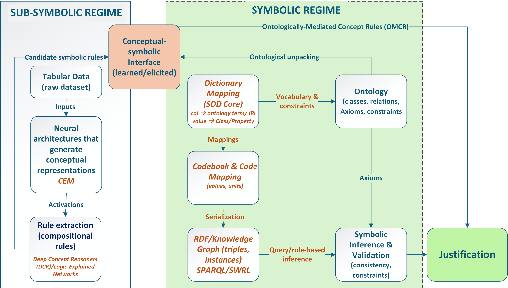

# Bridging Two Computational and Epistemic Regimes

**Related paper:** *Ontological Mediation in Explainable Artificial Intelligence: Concept-Based Models and Ontology-Grounded Explanatory Justification*  
**Authors:** Eduardo M. P. Coelho; Marcello Peixoto Bax  
**Preprint:** SciELO Preprints  
**DOI:** 10.1590/SciELOPreprints.18206  
**Status:** Supplementary visual artifact  
**Version:** 0.1 — October 2026  
**Documentation license:** CC BY 4.0

*Figure 3. Bridging two computational and epistemic regimes. Concept-based rules extracted or reconstructed from neural models are ontologically unpacked and transformed into Ontologically Mediated Concept Rules (OMCRs), which support symbolic inference, validation, and justificatory assessment of neural predictions. The ontological and conceptual artifacts instantiated in the case study are highlighted in orange italics (here, CEM and SDD).*
