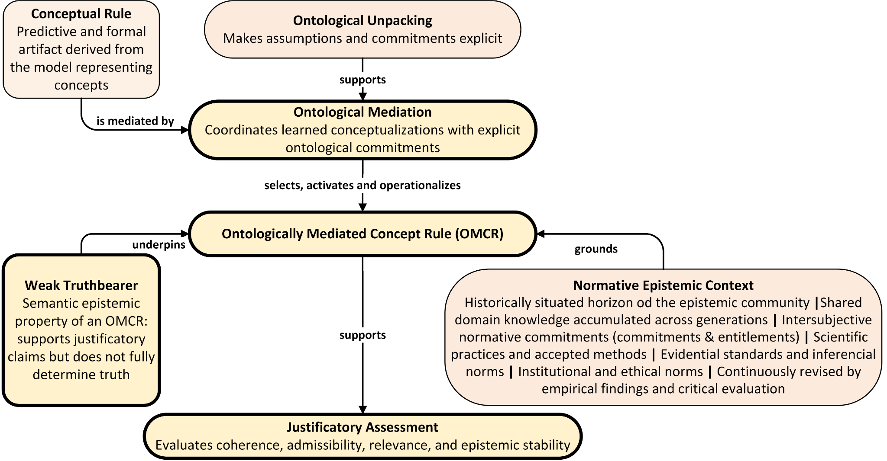

# Contribution-Focused Conceptual Map

**Related paper:** *Ontological Mediation in Explainable Artificial Intelligence: Concept-Based Models and Ontology-Grounded Explanatory Justification*  
**Authors:** Eduardo M. P. Coelho; Marcello Peixoto Bax  
**Preprint:** SciELO Preprints  
**DOI:** 10.1590/SciELOPreprints.18206  
**Status:** Supplementary visual artifact  
**Version:** 0.1 — October 2026  
**Documentation license:** CC BY 4.0

*Figure 2. Focused conceptual map of the core ontology-mediated justification pathway. The diagram shows how a Conceptual Rule, together with Ontological Unpacking, is mediated into an Ontologically Mediated Concept Rule (OMCR), grounded in the Normative Epistemic Context and underpinned by weak-truthbearer semantics, to support Justificatory Assessment. Yellow blocks with thick outlines indicate the authors’ principal contributions.*
