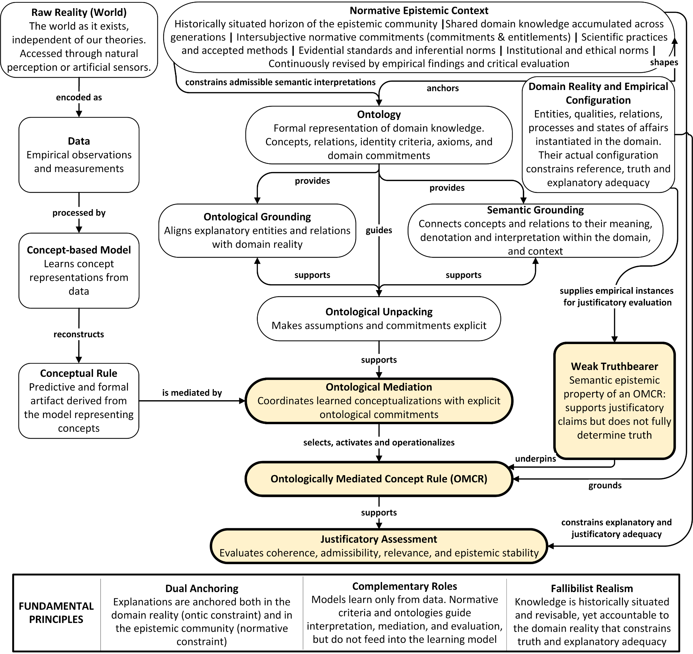

# Full Conceptual Map

**Related paper:** *Ontological Mediation in Explainable Artificial Intelligence: Concept-Based Models and Ontology-Grounded Explanatory Justification*  
**Authors:** Eduardo M. P. Coelho; Marcello Peixoto Bax  
**Preprint:** SciELO Preprints  
**DOI:** 10.1590/SciELOPreprints.18206  
**Status:** Supplementary visual artifact  
**Version:** 0.1 — October 2026  
**Documentation license:** CC BY 4.0

*Figure 1. High-level conceptual map of the proposed ontology-mediated justification framework. The diagram illustrates how domain reality shapes normative epistemic contexts, how ontological structures constrain admissible semantic interpretations, and how Ontological Mediation operationalizes Ontologically Mediated Concept Rules (OMCRs) to support context-dependent justificatory assessments through weak truthbearers. The blocks with a yellow background and thick outline indicate the authors’ contributions.*
