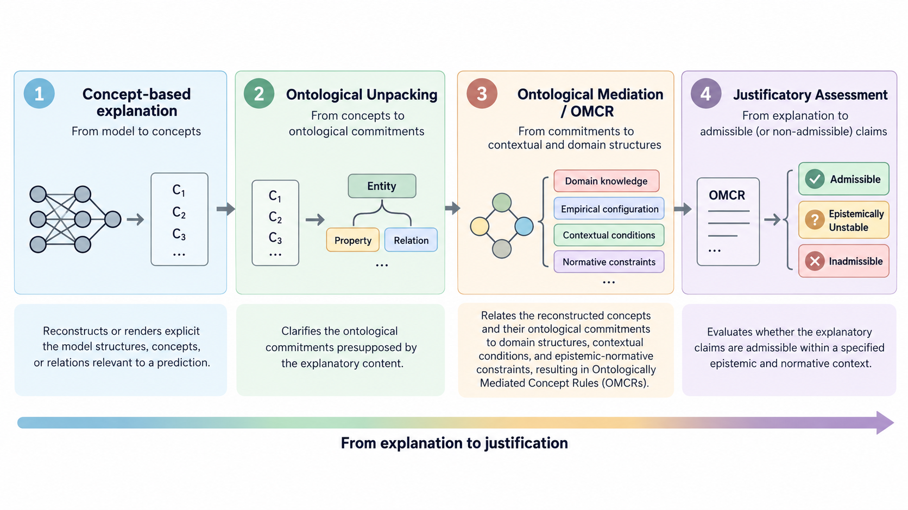

# From Ontological Unpacking to Justificatory Assessment: Main Contributions of the Ontological Mediation Framework for Explainable AI

## 1. The Central Contribution: Beyond Explanation Toward Justification

A central contribution of our work, within the architecture proposed here, is to make explicit and architecturally separate the claim that **Ontological Unpacking** is required for making relevant ontological commitments explicit, but is not by itself sufficient to establish the epistemic and normative admissibility of a model-derived explanation.

The framework therefore extends concept-based explainability beyond the reconstruction of learned relationships by introducing an explicit sequence of **ontological clarification, ontological mediation, and justificatory assessment**.

A large class of post-hoc and concept-based XAI approaches seeks to make machine-learning behavior understandable by identifying influential features, reconstructing decision rules, or exposing relationships among learned concepts. Concept-based approaches represent an important development in this direction because they provide explanatory structures at a level closer to human conceptual reasoning than raw numerical features.

However, an explanatory representation derived from a learned model does not thereby establish that the resulting explanatory content is semantically adequate, ontologically well-grounded, epistemically warranted, or normatively admissible.

Ontological Unpacking addresses an essential part of this problem. Following the ontological perspective developed by Guarino and Guizzardi [1], it makes explicit the ontological commitments embedded in conceptual descriptions, revealing the entities, properties, relations, and conditions presupposed by their interpretation. It thereby helps distinguish learned conceptual artifacts from the structures of reality that they purport to represent.

Yet making ontological commitments explicit is not equivalent to establishing the justificatory admissibility of an explanation.

A rule may employ ontologically legitimate concepts and relations while relying on insufficient evidence, questionable generalizations, inappropriate contextual assumptions, or criteria that are unacceptable within the relevant scientific, professional, or institutional practice. Ontological adequacy alone cannot settle these questions.

Our approach addresses this limitation by incorporating an additional evaluative level grounded in an explicit **Normative-Epistemic Context**. This context articulates the evidential standards, domain-specific constraints, institutional commitments, and other normative criteria against which explanatory claims may be critically assessed.

The resulting distinction is fundamental:

- **Explanation:** seeks to reconstruct or render explicit the model structures, concepts, or relations relevant to a prediction.
- **Ontological Unpacking:** clarifies the ontological commitments presupposed by that explanatory content.
- **Ontological Mediation:** relates those commitments to explicit domain structures, contextual conditions, and epistemic-normative constraints.
- **Justificatory Assessment:** evaluates whether the resulting explanatory claims are admissible within a specified epistemic and normative context.

Justificatory Assessment therefore does not merely produce another explanation. It evaluates explanatory content that has already been reconstructed and ontologically mediated. In this sense, the framework treats explanation as an intermediate product and its critical justificatory assessment as a further objective of the explanatory process.

*Figure 1. From concept-based explanation to justificatory assessment. Ontological Unpacking makes relevant ontological commitments explicit; Ontological Mediation relates them to domain, empirical, contextual, and normative structures; OMCRs function as mediated explanatory artifacts; and Justificatory Assessment evaluates the admissibility of the resulting claims (Image generated by ChatGPT based on the author's instructions.).*

## 2. Bridging Two Computational and Epistemic Regimes

A second major contribution is the articulation of a mediated architecture spanning two complementary computational and epistemic regimes. This distinction is analytical rather than exhaustive: hybrid systems may instantiate both regimes in varying degrees.

The first is the **subsymbolic regime**, represented by machine-learning models that acquire statistical regularities from empirical data. Concept-based models, including Concept Embedding Models (CEMs), and other approaches capable of exposing or reconstructing concept-level relationships provide mechanisms for gaining explanatory access to learned behavior.

These mechanisms are valuable, but they do not by themselves guarantee that learned concepts correspond to ontologically adequate representations or that concept-level relationships satisfy domain-specific epistemic and normative standards.

The second is the **symbolic and ontological regime**, comprising formal ontologies, conceptual models, explicit constraints, and structured domain knowledge. This regime provides resources for examining the meaning of learned concepts, articulating their ontological commitments, representing domain constraints, and specifying conditions under which explanatory claims may be assessed.

The framework does not seek to replace subsymbolic learning with symbolic reasoning. Instead, it establishes a mediated relationship between the two regimes while preserving their distinct explanatory and epistemic roles.

Statistical learning supplies empirically derived patterns and predictions. Ontological and epistemic structures provide conceptual, semantic, and normative resources for their critical examination.

The proposed architecture may employ semantic-integration mechanisms such as **Semantic Data Dictionaries (SDDs)** to connect empirical variables with formally represented domain concepts. In the Alzheimer-related OASIS-2 case study, SDDs and a CEM illustrate one possible instantiation of the broader architecture.

Neither SDDs nor CEMs constitute theoretical requirements of the framework. A CEM is one possible source from which a **CEM-specific Concept-Rule Base (CEM-CRB)** may be reconstructed or derived when an appropriate rule-reconstruction or extraction procedure is available. The broader notion of **Concept-Rule Base (CRB)** is intended to be source-agnostic and to accommodate concept-rule structures originating from other model families or derivational processes.

For the broader CRB conceptualization and research scope, see: [**Concept-Rule Base (CRB): Conceptualization, Knowledge Graphs, Generalization, and Research Scope**](../formalization/concept-rule-base.md).

The significance of the integration therefore lies not simply in attaching symbolic knowledge to neural outputs. Rather, the framework seeks to make learned explanatory structures semantically interpretable, ontologically explicit, and systematically assessable.

## 3. Ontological Mediation and Ontological Unpacking

The third contribution is the introduction of **Ontological Mediation** as an organizing process connecting learned conceptual representations with explicit ontological structures, empirical configurations, contextual conditions, and epistemic-normative constraints.

Within this architecture, Ontological Unpacking plays a central but deliberately delimited role.

Ontological Unpacking operates primarily at the interface between conceptual artifacts and their ontological commitments. Its task is to expose what a learned concept or rule presupposes about the domain: which kinds of entities are implicated, which properties and relations are involved, and which conditions must obtain for the conceptual description to be ontologically meaningful.

In this respect, Ontological Unpacking is fundamentally **meta-conceptual**. It does not independently establish why a particular model output should be accepted. Rather, it clarifies the ontological commitments underlying the concepts and relations through which that output is explained.

Ontological Mediation extends beyond this task. It relates reconstructed conceptual structures, their ontological profiles, the relevant empirical configuration, and the applicable epistemic-normative constraints. Ontological Unpacking does not automatically transform a Conceptual Rule into an OMCR; rather, it contributes commitments and distinctions that can participate in the mediation through which OMCRs are selected, constructed, or operationalized.

Its function is therefore not merely to add ontological vocabulary to learned rules, but to establish a structured interface through which concept-based explanatory content can be examined in relation to domain commitments, contextual conditions, and justificatory criteria.

This distinction also clarifies our relationship to prior work on Ontological Unpacking and truthmaking. Our claim is not that prior work lacks resources relevant to justification, but that our framework makes a distinct justificatory stage explicit and architecturally separate.

Ontological Unpacking and Ontological Mediation are therefore related but non-identical operations: the former makes ontological commitments explicit; the latter situates explanatory content within a broader network of ontological, empirical, contextual, and normative relations.

## 4. Ontologically Mediated Concept Rules and Weak Truthbearers

A fourth contribution is the introduction of **Ontologically Mediated Concept Rules (OMCRs)** as mediating representational structures through which learned explanatory relationships can be examined in relation to ontological commitments and epistemic-normative conditions.

OMCRs are not merely concept-based rules rewritten in ontological vocabulary.

They are **onto-epistemically situated explanatory artifacts** whose role is to mediate between reconstructed concept-level relationships and the domain structures, contextual conditions, and criteria relevant to their assessment.

This architecture supports an important distinction among at least three dimensions of explanatory evaluation: **predictive or statistical relevance; ontological coherence; and justificatory admissibility**.

These dimensions should not be conflated. A rule may be predictively useful without being epistemically or normatively defensible. Conversely, an ontologically coherent explanation may remain inadequately supported by evidence or inappropriate within the relevant normative context.

The framework also introduces the notion of a **Weak Truthbearer** to characterize explanatory claims as truth-apt contents whose acceptance remains defeasible and context-dependent.

Such claims are not treated as automatically true or justified merely because they are generated from a successful predictive model. Their admissibility remains conditional upon empirical evidence, ontological commitments, contextual information, and the relevant Normative-Epistemic Context.

**“Weak Truthbearer” is a project-specific term. “Weak” qualifies the defeasible justificatory status of the claim, not its truth-aptness.**

Weak Truthbearers therefore remain open to challenge, revision, defeat, and reassessment as evidence, ontological interpretation, or contextual commitments change.

In this sense, the framework adopts a fallibilist stance: explanatory claims may be treated as legitimate objects of truth-oriented and justificatory evaluation without presupposing that their truth or justification has already been established.

Together, OMCRs and Weak Truthbearers provide conceptual resources for representing explanations as objects that can be assessed, challenged, compared, defeated, and potentially revised.

## 5. Justificatory Assessment as a Distinct Evaluative Stage

The fifth contribution is the explicit characterization of **Justificatory Assessment** as a stage distinct from explanation generation, interpretation, Ontological Unpacking, and Ontological Mediation.

Its task is not simply to determine whether an explanation is intelligible or ontologically coherent.

Justificatory Assessment asks whether the explanatory claims under consideration are adequately supported by evidence, whether their ontological commitments are coherent, whether relevant contextual and normative constraints are satisfied, and whether conflicts, defeaters, or unresolved limitations affect their admissibility.

At the present conceptual stage, the framework provisionally distinguishes three principal justificatory statuses: **Admissible, Inadmissible, and Epistemically Unstable**.

These provisional statuses are intended to distinguish explanatory claims that satisfy the applicable assessment criteria from those that violate them or whose justificatory status remains unresolved.

**Admissibility is not equivalent to truth**, nor does an admissible status constitute an unconditional guarantee of correctness. Rather, admissibility expresses a positive assessment relative to explicitly identified evidential, ontological, contextual, and normative commitments.

Similarly, an **Epistemically Unstable** status does not necessarily indicate falsity. It indicates that the available grounds do not yet support a sufficiently stable justificatory judgment, for example because of evidential insufficiency, unresolved conflict, context sensitivity, or competing interpretations.

This distinction is particularly important in high-stakes domains. For example, a learned rule associating educational attainment with dementia classification may employ legitimate concepts and statistically relevant correlations while still raising questions concerning cognitive reserve, population differences, evidential sufficiency, fairness, or the appropriateness of using the relationship in a particular decision context.

Ontological Unpacking can clarify what the concepts mean and what ontological commitments the rule presupposes. Ontological Mediation can relate those commitments to relevant domain structures and contextual conditions. But neither operation independently determines whether the explanatory claim should be accepted as an adequate basis for a particular decision.

Justificatory Assessment provides the additional evaluative level at which such questions can be formulated and systematically examined.

## 6. Broader Significance and Research Outlook

Taken together, these contributions suggest an **extension of the objectives of XAI**: from making model predictions understandable toward making the explanations themselves systematically assessable.

The proposed framework combines concept-based explanatory structures, Ontological Unpacking, Ontological Mediation, OMCRs, Weak Truthbearers, and Justificatory Assessment within a conceptual architecture intended to support explicit and inspectable assessment of explanatory claims.

Its broader significance lies in the possibility of developing AI systems whose explanations are not merely intelligible to human observers, but are also open to systematic examination against explicit conceptual criteria, ontological commitments, empirical evidence, contextual constraints, epistemic standards, and normative requirements.

This is particularly relevant in domains in which explanations must support accountability, contestability, auditability, and human oversight, including healthcare, public administration, fraud detection, and other consequential decision-making environments.

The present contribution remains primarily conceptual and architectural.

Its operational mechanisms, formal properties, computational realization, and empirical effectiveness require further specification and evaluation. In particular, the precise formal relationships among CRBs, Ontological Mediation, OMCRs, Normative-Epistemic Contexts, Weak Truthbearers, and Justificatory Assessment remain part of an ongoing research program.

> **Ontological Unpacking provides a necessary foundation, within the proposed framework, for making the relevant ontological commitments of an explanation explicit; Justificatory Assessment is the distinct stage at which the framework examines whether the resulting explanatory content is epistemically and normatively defensible within a specified context.**

By making this additional evaluative stage explicit, the framework seeks to extend explainability from the reconstruction of model-derived explanatory content toward the critical assessment of the grounds on which such content may legitimately be accepted.

## Reference

[1] Guizzardi, G., & Guarino, N. *Semantics, ontology and explanation*. arXiv:2304.11124, 2023.
